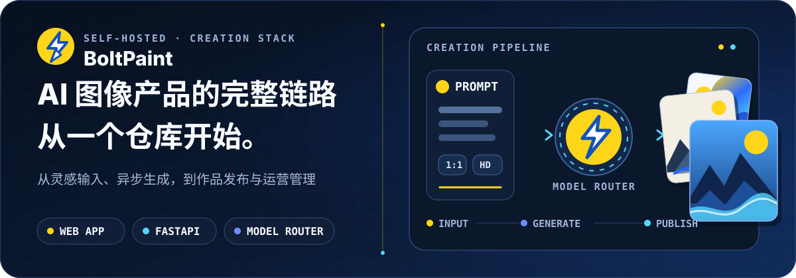
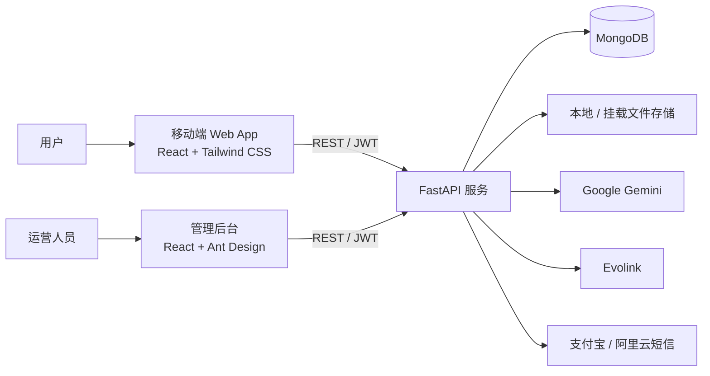

<div align="center">
  
  <br />
  <sub>
    Hero 作品为多风格创作能力的概念视觉；<br />
    实际输出取决于接入模型、提示词与生成参数。
  </sub>
  <br /><br />
  <a href="#快速开始"><strong>快速开始</strong></a>
  ·
  <a href="#核心能力">核心能力</a>
  ·
  <a href="#系统架构">系统架构</a>
  <br />
  <a href="#配置说明">配置说明</a>
  ·
  <a href="#项目文档">项目文档</a>
  <br /><br />
  
  
  <br />
  
  
  <br />
  
  
</div>

## 从灵感到发布，不止一个生成接口

BoltPaint 是面向 **AI 绘画产品开发者与运营团队** 的全栈、自托管解决方案。它把用户创作端、运营后台、异步任务、作品社区和商业化能力放进同一个仓库，让你从一条完整产品链路开始，而不是从零拼接页面与接口。

用户可以通过模板或自选模型发起创作、跟踪任务、保存并发布作品；运营人员可以管理模板、模型、定价、用户、订单、工单与系统配置。后端目前支持 Google Gemini 与 Evolink，并可通过配置继续扩展生成策略。

**English overview:** BoltPaint is an open-source, self-hosted AI image generation platform built with React, FastAPI, and MongoDB. It combines text-to-image creation, reference-image workflows, reusable prompt templates, asynchronous generation jobs, an artwork gallery and community, an admin dashboard, and credit-based billing. The backend integrates Google Gemini image models and Evolink; additional providers can be added through the generation service.

> [!IMPORTANT]
> 项目仍在持续开发。公开部署前，请完成[部署前安全检查](#部署前安全检查)，并按业务需要配置模型、短信与支付服务。

## 核心能力

| 产品链路 | 已覆盖能力 |
| --- | --- |
| **创作** | 模板创作、高级创作、提示词润色、参考图、多比例与多分辨率 |
| **工具** | 图片扩展、自动漫画、漫画页面重绘、自定义模板 |
| **任务与作品** | 异步生成、状态查询、作品保存与发布、点赞、收藏、个人作品管理 |
| **社区** | 作品广场、搜索与筛选、模板中心、标签体系 |
| **账户** | 注册登录、JWT 会话、短信验证码、激活码、资料与余额 |
| **商业化** | 模型计价、充值档位、订单管理、支付宝支付接入 |
| **运营** | 数据看板、用户、作品、模板审核、模型、定价、订单、工单与系统设置 |
| **基础设施** | MongoDB、本地/挂载存储、CORS、健康检查、Swagger 与 ReDoc |

## 系统架构



典型创作流程：

1. 用户选择模板或图像模型，提交提示词、比例、分辨率与参考图。
2. 后端校验账户余额与计价策略，创建异步生成任务。
3. 对应模型服务完成生成，后端持续更新任务状态。
4. 结果写入文件存储，用户将其保存为作品并选择是否发布。

## 技术栈

- **用户端：** React 18、TypeScript、Vite、Tailwind CSS、React Router、i18next
- **管理端：** React 18、TypeScript、Vite、Ant Design、Axios、Recharts
- **服务端：** Python、FastAPI、Uvicorn、Pydantic、Motor、PyMongo
- **数据与存储：** MongoDB 5.0、本地或挂载目录文件存储
- **外部服务：** Google Gemini、Evolink、支付宝、阿里云短信
- **部署：** Docker、Docker Compose、Nginx 反向代理

## 仓库结构

```text
BoltPaint/
├── webApp/                 # 用户端移动 Web 应用（端口 3001）
│   ├── components/         # 通用 UI 组件
│   ├── contexts/           # 全局状态与系统设置
│   ├── pages/              # 广场、模板、创作、任务、作品等页面
│   └── services/           # 后端 API 调用
├── manage/                 # 运营管理后台（端口 3002）
│   └── src/
│       ├── api/            # 管理端 API 封装
│       ├── layout/         # 后台布局
│       └── pages/          # 用户、模板、模型、订单、工单等模块
├── backend/                # FastAPI 服务（端口 8000）
│   ├── app/                # 路由、服务、配置与数据模型
│   ├── database/           # 初始化与迁移脚本
│   └── document/           # 接口、数据库、运维与接入文档
└── docker-compose.yml      # MongoDB 与后端生产编排
```

## 快速开始

### 环境要求

- Node.js 18+
- Python 3.10+
- MongoDB 5.0+
- npm

若要调用真实图像模型、短信或支付能力，还需要准备对应服务的 API Key 或应用凭据。

### 1. 获取代码并启动 MongoDB

```bash
git clone https://github.com/zhengzhoujiao/BoltPaint.git
cd BoltPaint
docker run --name boltpaint-mongo -p 27017:27017 -d mongo:5.0
```

如果本机已有 MongoDB，可以跳过最后一行。

### 2. 启动后端

```bash
cd backend
python -m venv .venv
```

```powershell
# Windows PowerShell
.\.venv\Scripts\Activate.ps1
```

```bash
# macOS / Linux
source .venv/bin/activate
```

```bash
pip install -r requirements.txt
python run.py
```

启动前请参考 [`backend/.env.example`](./backend/.env.example) 设置环境变量。非敏感开发配置可写入 `backend/.env`；密钥和首次初始化密码应写入已被 Git 忽略的 `backend/.env.local`。

服务启动后可检查：

- 健康状态：<http://localhost:8000/health>
- Swagger UI：<http://localhost:8000/docs>
- ReDoc：<http://localhost:8000/redoc>

### 3. 启动用户端

```bash
cd webApp
npm install
npm run dev
```

访问 <http://localhost:3001/boltPaint/>。开发服务器会把 API、静态文件和生成结果请求代理到 `http://localhost:8000`。

### 4. 启动管理端

```bash
cd manage
npm install
npm run dev
```

访问 <http://localhost:3002/boltPaint/JManage/>。

> [!WARNING]
> 数据库初始化脚本包含仅供本地开发使用的演示账户。首次登录方式见 [`backend/database/init_db.py`](./backend/database/init_db.py)；共享或公网部署前必须替换默认凭据。

## 配置说明

后端配置以 [`backend/.env.example`](./backend/.env.example) 为准：

| 变量 | 用途 | 何时必需 |
| --- | --- | --- |
| `MONGODB_URL` | MongoDB 连接地址 | 始终 |
| `MONGODB_DB_NAME` | 数据库名称 | 始终 |
| `PASSWORD_ENCRYPTION_KEY` | JWT 签名与用户密码加密密钥 | 始终 |
| `INITIAL_ADMIN_PASSWORD` | 首次创建管理员的密码 | 首次初始化 |
| `INITIAL_TEST_USER_PASSWORD` | 首次创建演示用户的密码 | 首次初始化 |
| `CORS_ORIGINS` | 允许访问 API 的前端来源 | 生产环境 |
| `NANO_BANANA_API_KEY` | Gemini 图像生成与提示词能力 | 使用 Gemini |
| `EVOLINK_API_KEY` | Evolink 图像模型调用 | 使用 Evolink |
| `OBJECT_STORAGE_DIR` | 上传、生成与自定义图片的存储根目录 | 可选 |
| `SMS_ENABLED`、`ALIYUN_*` | 阿里云短信验证码 | 启用短信 |
| `ALIPAY_*` | 支付宝下单、通知与回跳 | 启用支付 |

前端 API 地址可分别通过以下模板覆盖：

- 用户端：[`webApp/.env.example`](./webApp/.env.example) 中的 `VITE_API_BASE`
- 管理端：[`manage/.env.example`](./manage/.env.example) 中的 `VITE_API_URL`

## Docker 部署

根目录 [`docker-compose.yml`](./docker-compose.yml) 面向已有生产网络，负责 MongoDB 与后端编排；它不包含两个前端的一键部署。使用前需要：

1. 将根目录 `.env.example` 复制为 `.env`，设置 MongoDB 初始化凭据。
2. 创建或接入名为 `bolt_net` 的外部 Docker 网络。
3. 创建 `backend/.env.production` 并填写生产配置。
4. 分别构建 `webApp` 与 `manage`，再由 Nginx 托管静态文件并反向代理后端。

```bash
docker network create bolt_net
docker compose up -d --build
```

完整流程见 [`backend/document/运维维护手册.md`](./backend/document/运维维护手册.md)。

## 项目文档

- [后端服务说明](./backend/README.md)
- [接口文档](./backend/document/接口文档.md)
- [核心业务技术细节](./backend/document/核心业务技术细节设计文档.md)
- [数据库详细设计](./backend/document/数据库详细设计文档.md)
- [运维维护手册](./backend/document/运维维护手册.md)
- [Gemini 配置手册](./backend/document/Gemini手册.md)
- [支付宝接入指南](./backend/document/支付宝接入指南.md)
- [微信支付接入指南](./backend/document/微信支付接入指南.md)

## 部署前安全检查

- 清理 Git 历史中的真实密钥、证书和生产环境文件，并轮换曾提交过的凭据。
- 将本地与生产 `.env` 排除在版本控制之外，只保留无敏感信息的 `.env.example`。
- 修改数据库密码、默认管理员/测试账户与 `PASSWORD_ENCRYPTION_KEY`。
- 将 `CORS_ORIGINS=*` 收紧为实际使用的可信域名。
- 检查支付私钥、短信 AccessKey、模型 API Key 与回调地址。
- 为上传、限流、日志脱敏、备份和异常响应制定生产策略。

## 贡献

欢迎通过 Issue 提交问题或建议，也欢迎贡献 Pull Request：

1. Fork 仓库并创建功能分支。
2. 保持改动聚焦，提交前完成相关构建或测试。
3. 在 Pull Request 中说明背景、实现方式与验证结果。

## 开源许可

项目基于 [MIT License](./LICENSE) 开源。使用、修改或分发代码时，请同时确认所用模型、第三方服务与素材的许可条款。
